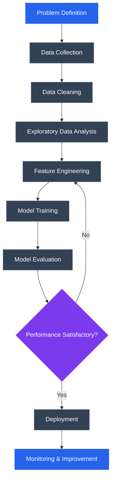

# Hi, I'm Tanmay Nolkha 👋

  

  
  
  

---

## 👨‍💻 About Me

I'm a third-year B.Tech student specializing in Artificial Intelligence and Data Science.

I enjoy exploring datasets, developing machine learning models, solving problems, and contributing to open-source projects.

- 🔭 Currently working on Data Science and ML projects.
- 🌱 Learning advanced Python, Machine Learning, and DSA.
- 🤝 Interested in Python-based open-source contributions.
- 🎯 Aspiring Data Scientist / ML Engineer.
- 📍 Jaipur, India.

---

## 🛠️ Tech Stack

**Languages**

**Data Science & Machine Learning**

**Tools & Development**

---

## 🔄 My Data Science Workflow

---

## 🚀 Featured Projects

### 1. Loan Approval Prediction
Machine learning classification project with a Flask application.

**Technologies:** Python, Scikit-learn, Flask

[View Repository](https://github.com/tanmaynolkha/Loan_Approval_Prediction)

### 2. E-Commerce Customer Segmentation
Customer segmentation using K-Means clustering to identify customer groups.

**Technologies:** Python, Pandas, NumPy, Scikit-learn

[Explore My GitHub](https://github.com/tanmaynolkha)

### 3. Rajasthan Trails and Tales
A tourism-focused digital platform prototype.

### 4. FarmSathi
A smart irrigation system prototype for precision farming.

---

## 🌍 Open Source Journey

- Contributed to [Hiero Java SDK](https://github.com/hiero-ledger/hiero-sdk-java).
- Exploring Python and Data Science repositories.
- Interested in documentation, bug fixes, testing, and feature development.

---

## 🏆 Achievements

- 🥇 1st Place — JIGYASA 2025 Ideathon.
- 🥉 3rd Place — Astrohunt, SKIT Jaipur.
- ⭐ NPTEL Star — Java Programming (91%).
- 🎓 Tata GenAI Powered Data Analytics Virtual Internship.

---

<h2 align="center">📊 GitHub Statistics</h2>

  
  

  

<!-- BEGIN ACTIVITY-GRAPH -->
<!-- END ACTIVITY-GRAPH -->
---

## 🐍 Contribution Snake

  

---

## 📫 Connect With Me

  
  

  <i>"Learning, building, and contributing — one commit at a time."</i>

