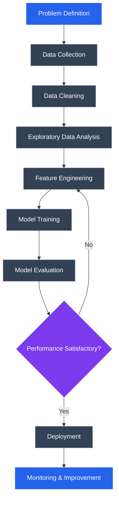

# Hi, I'm Tanmay Nolkha 👋

  

  
  
  

---

## 👨‍💻 About Me

I'm a third-year B.Tech student specializing in Artificial Intelligence and Data Science.

I enjoy exploring datasets, developing machine learning models, solving problems, and contributing to open-source projects.

- 🔭 Currently working on Data Science and ML projects.
- 🌱 Learning advanced Python, Machine Learning, and DSA.
- 🤝 Interested in Python-based open-source contributions.
- 🎯 Aspiring Data Scientist / ML Engineer.
- 📍 Jaipur, India.

---

## 🛠️ Tech Stack

**Languages**

**Data Science & Machine Learning**

**Tools & Development**

---

<h2 align="center">🚀 Featured Projects</h2>

  Building practical solutions using Data Science,
  Machine Learning and Python.

<table>
<tr>
<td width="50%">
<h3 align="center">📊 Customer Segmentation</h3>

Applied K-Means clustering to group customers
and discover meaningful patterns in customer data.

Python · Pandas · Scikit-learn · K-Means

<a href="https://github.com/tanmaynolkha/Customer_segmentation">
View Repository →
</a>

</td>

<td width="50%">
<h3 align="center">🏦 Loan Approval Prediction</h3>

An ML-based loan approval prediction system
with a Flask web application.

Python · Scikit-learn · Flask

<a href="https://github.com/tanmaynolkha/Loan_Approval_Prediction">
View Repository →
</a>

</td>
</tr>

<tr>
<td width="50%">
<h3 align="center">🌍 Population Growth Forecasting</h3>

Analyze population trends and forecast future
population using regression.

Python · Flask · Scikit-learn

<a href="https://github.com/tanmaynolkha/population_growth_forecasting">
View Repository →
</a>

</td>

<td width="50%">
<h3 align="center">🚗 Car Price Prediction</h3>

A machine learning project focused on
car price prediction.

Python · Jupyter Notebook

<a href="https://github.com/tanmaynolkha/ml_project">
View Repository →
</a>

</td>
</tr>
</table>

## 🔄 My Data Science Workflow

---

## 🌍 Open Source Journey

- Contributed to [Hiero Java SDK](https://github.com/hiero-ledger/hiero-sdk-java).
- Exploring Python and Data Science repositories.
- Interested in documentation, bug fixes, testing, and feature development.

---

## 🏆 Achievements

- 🥇 1st Place — JIGYASA 2025 Ideathon.
- 🥉 3rd Place — Astrohunt, SKIT Jaipur.
- ⭐ NPTEL Star — Java Programming (91%).
- 🎓 Tata GenAI Powered Data Analytics Virtual Internship.

---
## 🧩 LeetCode Stats

  

<h2 align="center">📊 GitHub Statistics</h2>

  
  

  

## 📊 Contribution Activity

<!-- BEGIN ACTIVITY-GRAPH -->
<picture>
  <source media="(max-width: 767px)" srcset="activity-graph-mobile.svg">
  
</picture>
<!-- END ACTIVITY-GRAPH -->

---

## 🐍 Contribution Snake

  

---

## 📫 Connect With Me

  
  

  <i>"Learning, building, and contributing — one commit at a time."</i>

